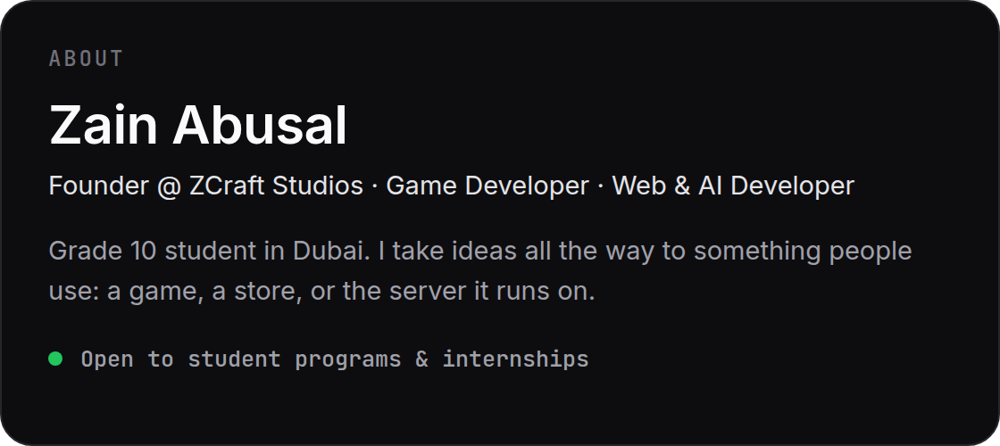
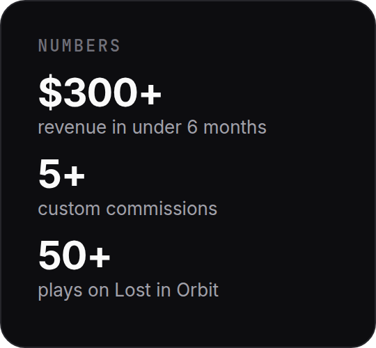
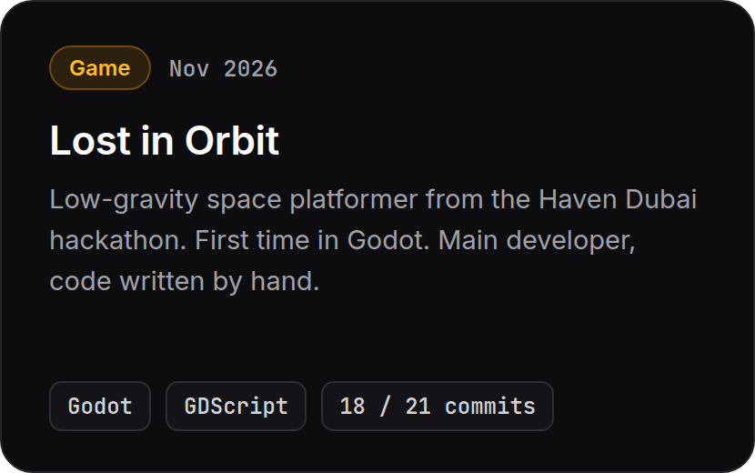
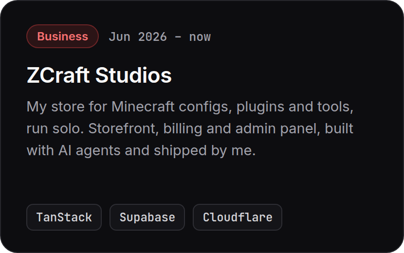
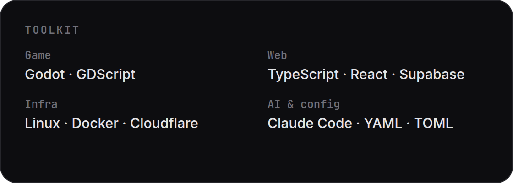
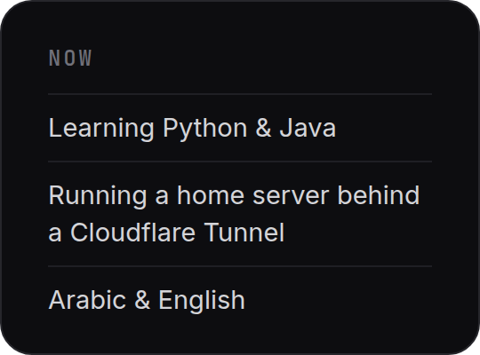

<a href="https://www.linkedin.com/in/zain-abusal/">LinkedIn</a> &nbsp;·&nbsp;
<a href="https://www.zainabusal.dev">Portfolio</a> &nbsp;·&nbsp;
<a href="https://www.zcraftstudios.com">ZCraft Studios</a> &nbsp;·&nbsp;
<a href="https://github.com/Zain-Abusal/Haven-Dubai">Lost in Orbit source</a> &nbsp;·&nbsp;
<a href="mailto:hello@zainabusal.dev">hello@zainabusal.dev</a>

