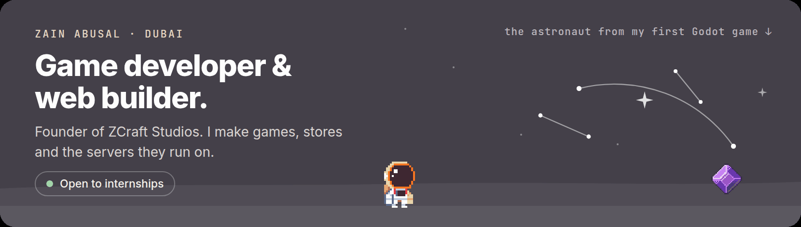
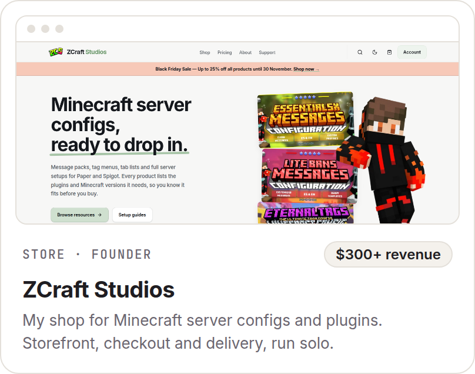
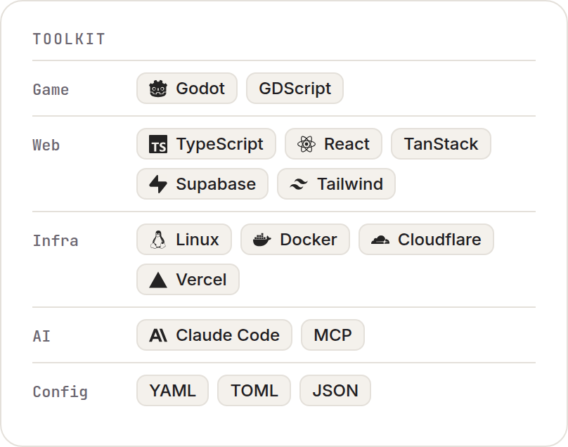
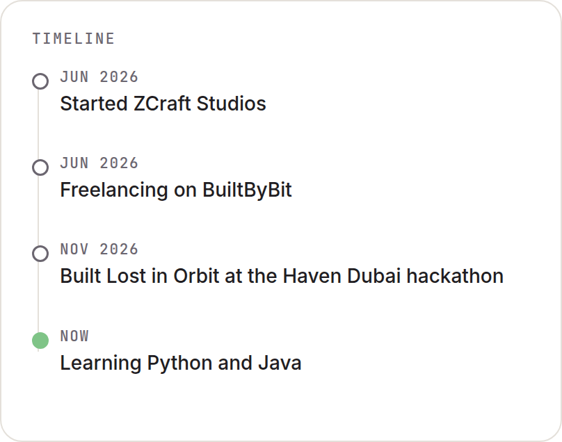
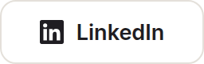
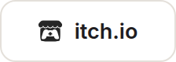
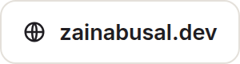
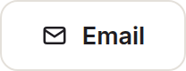

Grade 10 student in Dubai. I like taking an idea all the way to something people use. Some of it I code by hand, some I build with AI agents like Claude Code. Either way I read it, test it and ship it myself.

### Things I've built

<a href="https://zain-abusal.itch.io/lost-in-orbit"><picture><source media="(prefers-color-scheme: dark)" srcset="assets/cards/orbit-dark.png"></picture></a>
<a href="https://www.zcraftstudios.com"><picture><source media="(prefers-color-scheme: dark)" srcset="assets/cards/zcraft-dark.png"></picture></a>

<a href="https://github.com/Zain-Abusal/code-sherlock"><picture><source media="(prefers-color-scheme: dark)" srcset="assets/cards/sherlock-dark.png"></picture></a>
<picture><source media="(prefers-color-scheme: dark)" srcset="assets/cards/server-dark.png"></picture>

Also: <a href="https://github.com/Zain-Abusal/zcraft-invoice-hub">ZCraft Invoices</a>, turns a commission into a Tebex payment link. Game source lives in <a href="https://github.com/Zain-Abusal/Haven-Dubai">Haven-Dubai</a>.

### How I work

<picture><source media="(prefers-color-scheme: dark)" srcset="assets/cards/toolkit-dark.png"></picture>
<picture><source media="(prefers-color-scheme: dark)" srcset="assets/cards/timeline-dark.png"></picture>

### Say hi

<a href="https://www.linkedin.com/in/zain-abusal/"><picture><source media="(prefers-color-scheme: dark)" srcset="assets/buttons/btn-linkedin-dark.png"></picture></a>
<a href="https://zain-abusal.itch.io"><picture><source media="(prefers-color-scheme: dark)" srcset="assets/buttons/btn-itch-dark.png"></picture></a>
<a href="https://www.zainabusal.dev"><picture><source media="(prefers-color-scheme: dark)" srcset="assets/buttons/btn-website-dark.png"></picture></a>
<a href="mailto:hello@zainabusal.dev"><picture><source media="(prefers-color-scheme: dark)" srcset="assets/buttons/btn-email-dark.png"></picture></a>

