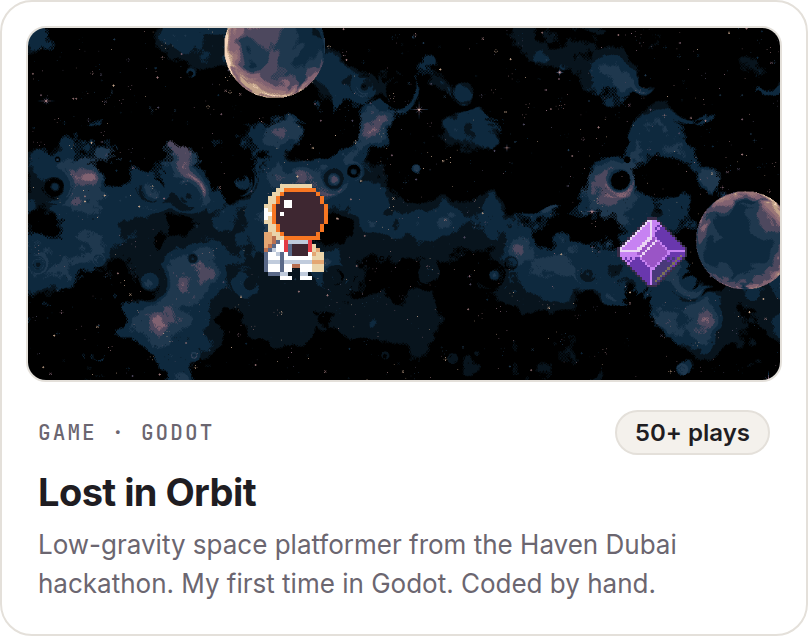
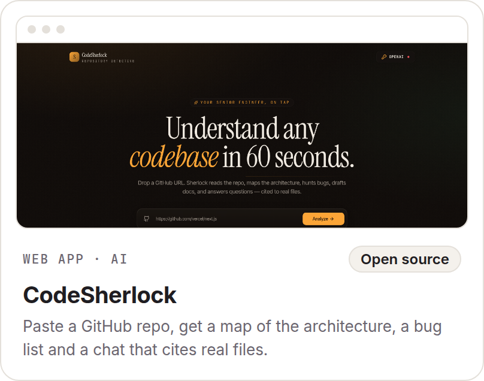
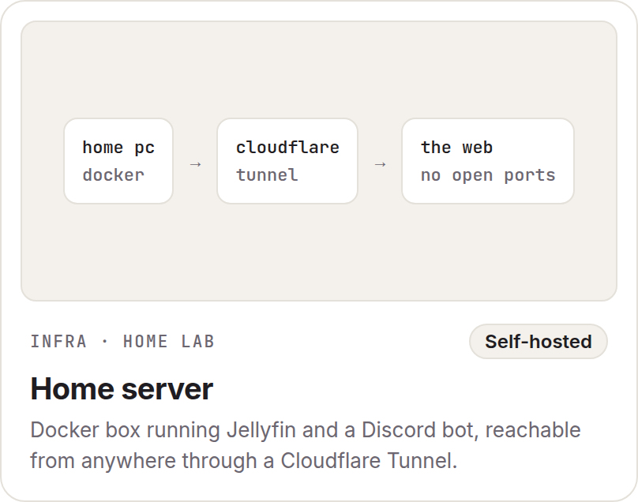

Grade 10 student in Dubai. I like taking an idea all the way to something people use. Some of it I code by hand, some I build with AI agents like Claude Code. Either way I read it, test it and ship it myself.

### Things I've built

<a href="https://zain-abusal.itch.io/lost-in-orbit"><picture><source media="(prefers-color-scheme: dark)" srcset="assets/cards/orbit-dark.png"></picture></a>
<a href="https://www.zcraftstudios.com"><picture><source media="(prefers-color-scheme: dark)" srcset="assets/cards/zcraft-dark.png"></picture></a>

<a href="https://github.com/Zain-Abusal/code-sherlock"><picture><source media="(prefers-color-scheme: dark)" srcset="assets/cards/sherlock-dark.png"></picture></a>
<picture><source media="(prefers-color-scheme: dark)" srcset="assets/cards/server-dark.png"></picture>

Also: [ZCraft Invoices](https://github.com/Zain-Abusal/zcraft-invoice-hub), a small tool that turns a commission into a Tebex payment link. Game source is in [Haven-Dubai](https://github.com/Zain-Abusal/Haven-Dubai).

### What I use

Plus Claude Code for building with AI, and a lot of YAML and TOML for Minecraft servers.

### Right now

- Learning Python and Java
- Looking for a student program or internship in software, AI or games

[LinkedIn](https://www.linkedin.com/in/zain-abusal/) · [itch.io](https://zain-abusal.itch.io) · hello@zainabusal.dev
