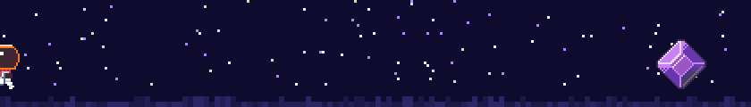

### Hey, I'm Zain.

Grade 10, Dubai. I ship things. Some of them I code by hand, some I build with AI agents, and every one of them ends up in front of real people who use it.

**Things I've made**

- **[Lost in Orbit](https://zain-abusal.itch.io/lost-in-orbit)**: a space platformer I coded by hand in Godot at the Haven Dubai hackathon, the first time I'd ever opened Godot. 50+ plays. [Source](https://github.com/Zain-Abusal/Haven-Dubai)
- **[ZCraft Studios](https://www.zcraftstudios.com)**: my Minecraft config and plugin shop. $300+ and 5+ custom commissions in under 6 months. No team.
- **[CodeSherlock](https://code-sherlock-one.vercel.app)**: point it at a GitHub repo, get an interactive workspace for it.
- **[ZCraft Invoices](https://github.com/Zain-Abusal/zcraft-invoice-hub)**: fill in a commission and get a Tebex payment link back.

My ISP said I couldn't host a server from home. My Cloudflare Tunnel disagreed.

`Godot` `GDScript` `TypeScript` `React` `Supabase` `Cloudflare` `Docker` `Linux` `Claude Code`

Open to student programs and internships in software, AI or games. Say hi on [LinkedIn](https://www.linkedin.com/in/zain-abusal/) or at hello@zainabusal.dev.
