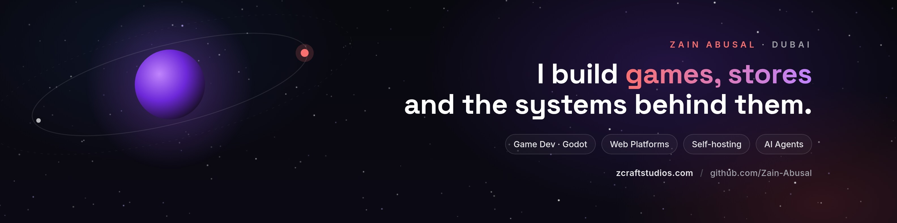

### Hi, I'm Zain

I'm a grade 10 student in Dubai and the founder of ZCraft Studios. I like taking an idea all the way to something people can actually use, whether that's a game, a store or the server it runs on.

### Featured work

<table>
<tr>
<td width="50%" valign="top">

<b>Lost in Orbit</b> &nbsp;Godot · GDScript · Haven Dubai hackathon

A low-gravity space platformer for the theme <i>Bounce Back</i>. My first time in Godot. I was the main developer and wrote the code by hand, 18 of the team's 21 commits. 50+ plays.

<a href="https://zain-abusal.itch.io/lost-in-orbit">Play it</a> &nbsp;·&nbsp; <a href="https://github.com/Zain-Abusal/Haven-Dubai">Source</a>
</td>
<td width="50%" valign="top">

<b>ZCraft Studios</b> &nbsp;TanStack Start · Supabase · Cloudflare

My store for Minecraft configs, plugins and tools. $300+ revenue and 5+ custom commissions in under 6 months, run solo. I build it with AI agents: I plan the work, review every change and ship it.

<a href="https://www.zcraftstudios.com">Visit</a> &nbsp;·&nbsp; <a href="https://builtbybit.com/zcs">BuiltByBit</a>
</td>
</tr>
</table>

### Toolkit

| | |
|---|---|
| **Game dev** |   |
| **Web** |      |
| **Infra** |     |
| **AI** |  |
| **Config** |    |

### Right now

- Learning Python and Java properly
- Running a home server (Docker, Jellyfin, a Discord bot) behind a Cloudflare Tunnel, because my ISP's CGNAT gives me no public IP
- Open to student programs, internships and projects in software, AI or game dev

Arabic & English · Dubai, UAE

